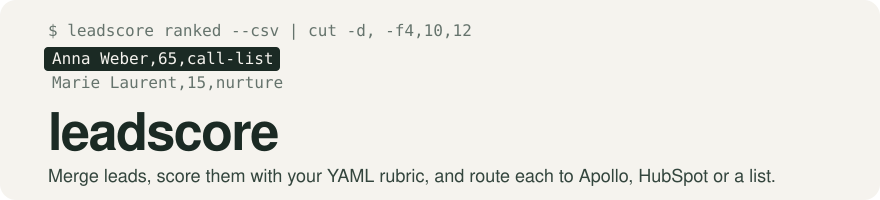
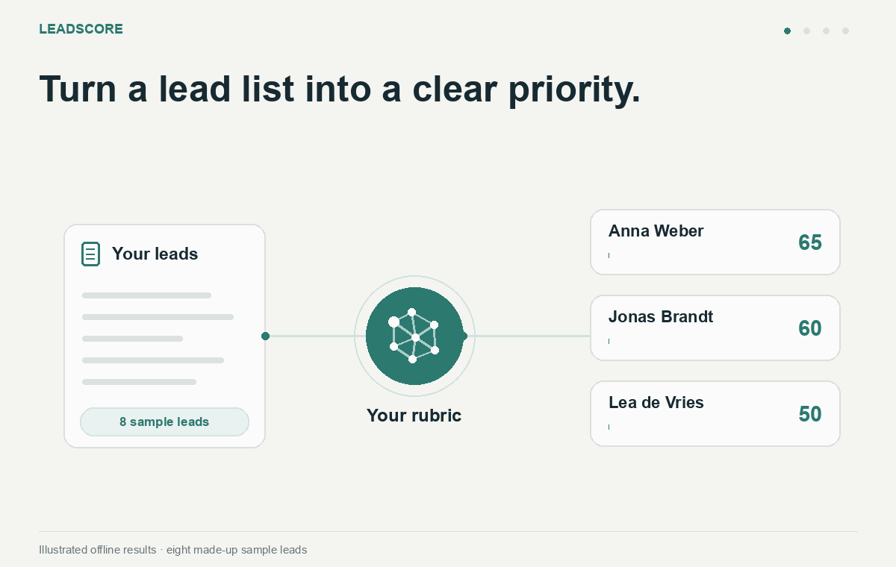

<picture>
  <source media="(prefers-color-scheme: dark)" srcset=".github/assets/banner-dark.svg">
  
</picture>



Your rubric. Clear priorities. [Demo notes](.github/assets/demo/README.md).

[](docs/reference.md)
[](LICENSE)


A small sales team gets leads from conference lists, lead sheets and website visits. leadscore
merges them into people on a schedule, scores them with a rubric you write in YAML, and sends
eligible leads to Apollo or HubSpot, and keeps matching export lists for your own sending tool.

## Contents

- [What it does](#what-it-does) lists the commands and the plug-in API, and what leadscore does not do.
- [Quick start](#quick-start) scores the sample leads on your machine in a few minutes.
- [Choosing a path](#choosing-a-path) maps what you have to one of three ways to run it.
- [Usage](#usage) sums up each path, the export lists, and how to check on a running install.
- [Reference](#reference) covers the commands, the rubric, enrichment, HubSpot and the receiver.
- [Before you rely on it](#before-you-rely-on-it) lists what is not yet checked against the real vendors, and other limits.
- [Project](#project) covers versioning, tests, contributing and the license.

## What it does

leadscore is one binary. Each run reads your leads, merges rows that are the same person, and
scores every lead with your rubric. It chooses at most one cold outreach lane per person;
matching non-cold lanes and export lists are evaluated independently.

A lead can appear once in each matching export lane. leadscore also reads replies and opt-outs
back, so it skips anyone it knows has opted out, and cold-contacts no one twice.

- `leadscore run` does one run. Leads come from CSV files, Google Sheet tabs and Apollo
  webhooks. Results go to Apollo sequences, HubSpot contacts and deals, or export lists kept
  as CSV files or Sheet tabs.
- `leadscore run --dry-run` prints what a run would change, and writes and spends nothing.
- `leadscore serve` is the receiver, the always-on address Apollo sends replies, opt-outs and
  website visits to. With `--every` it also runs on a timer.
- `leadscore doctor` and `leadscore status` check the install and print each problem with its
  fix.
- `leadscore ranked` and `leadscore explain` show every lead's score and the reasons behind it.
  The [Quick start](#quick-start) prints a ranking.
- The module root is a Go package, `leadscore`. A custom build can add its own source, store or
  sink as a plug-in ([Plug-ins](docs/reference.md#plug-ins)).

What it does not do:

- It sends no email itself. Apollo, HubSpot or your own tool sends.
- It finds no new leads. You bring them, and Apollo can fill in company facts.
- It has no alerting in v1. Someone has to look ([Health, status and doctor](#health-status-and-doctor)).
- It has no web interface. With a Google Sheet as the store, the Sheet is the interface.

## Quick start

You need Go 1.26 or later and a terminal on macOS, Linux or Windows (WSL). No account or key is
needed: this scores the made-up leads in `examples/leads.csv` with the example rubric and writes
the lists.

```sh
git clone https://github.com/tetriz-ai/leadscore.git
cd leadscore
go build -o leadscore ./cmd/leadscore
mkdir -p try
cp examples/leads.csv try/leads.csv
cp examples/rubric.csv-only.yml try/rubric.yml
cd try
cat > leadscore.yml <<'EOF'
version: 1
store: { type: sqlite, path: leadscore.db }
sources:
  - { id: leads, type: csv, path: leads.csv }
export: { dir: out }
EOF
../leadscore run
../leadscore ranked --csv | cut -d, -f4,10,12
ls out
```

```text
run <run id>: healthy; 8 lead(s) scored, 8 input row(s) merged, 0 left for later runs, 0 pushed; open problems: store:sample_leads
full_name,score,lane
Anna Weber,65,call-list
Jonas Brandt,60,call-list
Lea de Vries,50,call-list
Pia Schulz,50,call-list
Ines Ruiz,40,call-list
Marie Laurent,15,nurture
Tom Hale,0,
Sam Ortiz,0,
call-list.csv
nurture.csv
```

`store:sample_leads` is a warning, not a failure: every email is at a `.example` domain, so
leadscore knows these leads are made up. The example rubric has two export lanes, which keep
lists for you to send from your own tool, so there are two lists in `out/`. Tom Hale and Sam Ortiz
work at companies the rubric rules out, so they are on no list.

Before you email anyone on a list, drop rows where `do_not_contact` is `yes`. Every list has that
column, and [Export lists](#export-lists) says when it is `yes`.

To see why a lead scored as it did, run `../leadscore explain anna.weber@kranlogistik.example`.
Edit `rubric.yml` and run again to see the ranking change. When you are ready for your own leads,
pick a path in [Choosing a path](#choosing-a-path).

## Choosing a path

| You have | Use | Example |
|---|---|---|
| A CSV of leads, and you want scored lists to send from yourself | [Path 1: CSV only](#path-1-csv-only) | [leadscore.csv-only.yml](examples/leadscore.csv-only.yml) |
| A Google Cloud project with billing, and a team that works in a Google Sheet | [Path 2: Google Cloud](#path-2-google-cloud) | [leadscore.gcp.yml](examples/leadscore.gcp.yml) |
| A server with a domain, for live Apollo webhooks | [Path 3: Docker](#path-3-docker) | [leadscore.server.yml](examples/leadscore.server.yml) |
| A laptop, to try it with Apollo or HubSpot | [Path 3: Docker](#path-3-docker) | [leadscore.laptop.yml](examples/leadscore.laptop.yml) |

Every path runs the same binary and rubric. Every path needs someone comfortable with a terminal
for setup.

Not sure? Start with CSV only. It takes ten minutes, needs no accounts, and every other path
builds on it.

On every path, runs start with pushes off. leadscore scores and lists, a person reviews a dry
run, and only then turns pushing on.

## Usage

[docs/setup.md](docs/setup.md) has the full runbook for each path, step by step. Each step says
whether an agent or a person does it, so a coding agent can follow it too. An agent asks where
your leads are before it copies or runs anything, never makes leads up, and asks you for the
Apollo sending mailbox instead of picking one.

Releases are source-only: build the CLI with Go, or build your own Docker image
([Install the CLI](docs/setup.md#install-the-cli)).

### Path 1: CSV only

When: you want scored lists from CSV files, with no vendor account.

Copy `examples/leadscore.csv-only.yml` and `examples/rubric.csv-only.yml` beside your CSV, write
the rubric, and run `leadscore run`. It runs as the plain binary or on Docker. The full steps are
in [Path 1: CSV only](docs/setup.md#path-1-csv-only).

Remember:

- **Keep the example's export lanes only.** A cold lane is first outreach to someone who has not
  talked to you, such as an Apollo sequence. [Export lists](#export-lists) says why a CSV-only
  team drops them.

### Path 2: Google Cloud

When: you want runs on a schedule with nothing on your own machine, and a Google Sheet as the
store.

The receiver runs as a Cloud Run service, and each run as a Cloud Run job that Cloud Scheduler
starts. `setup/gcp.sh` does each setup step in turn, from the accounts and secrets to the deploy
and the schedule. The full steps are in [Path 2: Google Cloud](docs/setup.md#path-2-google-cloud).

Remember:

- **The spreadsheet holds personal data.** Share it only with named people, never by link.
- **Watch the receiver.** Set an uptime monitor on `<public_url>/healthz`.

### Path 3: Docker

When: you have a server with a domain for live webhooks, or a laptop to try it on.

One container runs the receiver and a run every `schedule`, with SQLite on a named volume.
From the source checkout, build `docker build -t leadscore:local .` before copying the
configuration into its own folder. `compose.yaml` uses that local image and never pulls it.
To use another locally built image, set `LEADSCORE_IMAGE` in `.env`.

The full steps are in [Path 3: Docker](docs/setup.md#path-3-docker-a-laptop-or-a-server).

Remember:

- **A laptop has no public address.** It polls Apollo for replies, or uses a Cloudflare Tunnel
  that works only while the laptop is awake.
- **Watch the receiver.** Set an uptime monitor on `<public_url>/healthz`.

### Export lists

An `export` lane in the rubric keeps a list instead of pushing to a tool. Each lane gets one
table, `Export <lane id>`, which is a tab on a Sheets store. On SQLite it also gets one CSV in
`export.dir` (`./out` on Docker), rewritten after every run.

- **Listed once per export lane.** A lead can belong to multiple matching export lists; it is
  listed once in each lane, the first run it matches. A run adds at most
  `ingest_chunk_rows` (2,000) new rows across all lists, and the rest follow in later runs. Every
  run refreshes each row's `status` and `do_not_contact`, also for lanes since removed from the
  rubric.
- **`do_not_contact`.** It is `yes` when the lead opted out or is blocked, is at a company with an
  open or won deal, was already contacted, or matches a cold lane. Opt-outs reach the lists from
  the receiver, polling and `Overrides`. The Apollo and HubSpot opt-out lookups run only for
  leads about to be pushed.
- **Cold lanes.** A cold lane claims its leads even before its sink is set up, the sink being
  its Apollo or HubSpot block in `leadscore.yml`. So anyone it matches is `do_not_contact`, and a
  CSV-only team removes the cold lanes from its rubric (`doctor` warns `cold_lane_no_sink:<lane>`).
- **Formulas.** A cell that a spreadsheet would read as a formula, one starting with `=`, `+`,
  `-` or `@`, is quoted with a leading `'` in the CSV files and in `ranked --csv` and
  `facts --csv`. So opening them in Excel or Sheets never runs a formula a lead's data carried.
- **CSV files.** CSV files are written only for a SQLite store, with mode 0600, because they hold
  personal data. A plug-in store (for example Postgres, `docs/postgres-store.md`) keeps its lists
  as tables in that store.

### Health, status and doctor

- `leadscore status` prints the last run's result and every open problem, each with its fix.
- `leadscore doctor` prints one line per check, each problem with its fix. It only reads, and
  exits 1 when a check fails. [Doctor checks](docs/reference.md#doctor-checks) lists them.
- With a Google Sheet as the store, the `Health` tab's cell `H1` reads `STALE` in red when no run
  has succeeded in three `schedule` intervals.
- On Docker, `docker ps` shows the container unhealthy when `/healthz` answers 503
  ([Receiver](docs/reference.md#receiver) says when).
- `SKILL.md` has a troubleshooting entry for every doctor check, and the loop for changing the
  rubric safely.

## Reference

[docs/reference.md](docs/reference.md) has the exact formats. This section covers what you need
while setting up.

### Commands

`leadscore help` lists every command, and [Commands](docs/reference.md#commands) describes each.

### The rubric

Your ideal customer is one YAML file, the rubric. It says which columns matter, how to label each
company and person, how to score them, and where each lead goes. Start from `examples/rubric.yml`
for Apollo and HubSpot lanes, or `examples/rubric.csv-only.yml` for lists only.

Check a rubric with `leadscore rules check rubric.yml`, which lists every problem with its line.
The full format is in [The rubric](docs/reference.md#the-rubric). `SKILL.md` has the loop for
changing it safely.

### Enrichment

With an `enrich` block, each run looks up company facts in Apollo for the companies of your
leads, using `APOLLO_API_KEY`. The facts are name, headcount, funding stage, country and latest
funding date.

```yaml
enrich: { type: apollo, max_age: 30d, max_lookups_per_run: 100, max_lookups_per_day: 400 }
```

[Vendors](docs/reference.md#vendors) says when a company is looked up, which value wins, and
what a failed lookup does.

### HubSpot

Add a `sinks.hubspot` block and set `HUBSPOT_TOKEN` to a private app's token:

```yaml
sinks:
  hubspot: { pipeline: Sales Pipeline, stage: Appointment scheduled }
```

`leadscore setup hubspot` creates the custom properties (`leadscore_lead_id` and friends, in a
`leadscore` group) and checks that the pipeline and stage exist. Run it once, and again after
changing `property_prefix`. It needs the schema write scopes, and runs need contacts and deals
read and write, companies read, and schema read.

A lane pushing to `hubspot:contacts` finds or creates the person's contact, and
`hubspot:deals` also opens or joins the company's deal. [Vendors](docs/reference.md#vendors) has
the properties, the steps and the lookups that run before every push.

### The receiver

`leadscore serve` accepts Apollo workflow requests at `POST /apollo/reply` for sent emails,
replies and opt-outs, and at `POST /apollo/visit` for website visits. Bodies follow the templates
in `setup/apollo/`, and each request carries the receiver secret in the `X-Leadscore-Secret`
header.

The receiver answers 200 only once the event is stored, so Apollo can send a refused one again.
[Receiver](docs/reference.md#receiver) has every route and answer, events stored during a run,
silence checks and receiver-only leads.

#### Keep the receiver secret private

The receiver secret (`LEADSCORE_RECEIVER_SECRET`) works like a password: anyone who has it can
send fake events, including a fake positive reply that a deal lane would act on. Never paste it
into chat, tickets or shared docs. Type it only into `.env` (or Secret Manager) and the Apollo
workflows, and rotate it if it might have leaked.

Make a new secret with `openssl rand -hex 32`. To rotate it without losing a webhook, follow
[Receiver](docs/reference.md#receiver) on Docker, or "Rotating a secret" in
[Path 2](docs/setup.md#path-2-google-cloud) on Google Cloud.

## Before you rely on it

These limits matter before you push to real people or send from a list.

### Not yet checked against live Apollo and HubSpot

The tests run against fake Apollo and HubSpot APIs. Some of the fakes' answers were recorded from
a real Apollo account, and the rest follow the vendors' docs.

Read-only calls to a real Apollo account recorded the sign-in check, a refused key, the mailbox
list, the sequence search, the reply search and the error answer for an unknown contact. The
rest is not yet checked against a real account.

- **Apollo writes.** Creating a contact and adding it to a sequence follow Apollo's docs.
- **Apollo details.** Whether the contact search spends credits, a real 429 answer, and five of
  the eight documented reply labels.
- **Apollo workflow retries.** Whether Apollo resends a webhook that failed is unknown. If it does
  not, an event answered 503, or sent while the receiver was down or a laptop slept, is lost.
  Silence detection notices a workflow that goes quiet, not a single lost event.
- **HubSpot.** Every call. The HubSpot sink and its lookups are tested only against fakes built
  from HubSpot's docs.
- **Google Cloud.** The live check has not run on a billed project.

Before the first real push, review a dry run, and push to a small test sequence or a test HubSpot
pipeline first.

### Opt-outs

**Apollo-only pushes wait for unsubscribe evidence.** Leadscore cannot yet read an opt-out
flag on Apollo's contacts. Until an `unsubscribed` webhook has reached the receiver, Apollo
pushes are blocked with `apollo-key:no_optout_flag`. Merely configuring a receiver does not
release the block. Configure Apollo's unsubscribe workflow and verify delivery with a test
contact, or configure HubSpot so its opt-out lookup runs before pushes. Lookup failures keep
affected leads waiting. Other sinks and export generation continue normally.

A received event demonstrates that the route works once; it does not prove that every historic
or future unsubscribe is delivered. Apollo's retry behavior remains unverified. Import existing
opt-outs before enabling pushes and continue monitoring delivery.

**Export lists** can list someone who opted out only in Apollo or HubSpot, as
[Export lists](#export-lists) explains.

**Blocks someone it could contact:** a lead at a company with an open or won HubSpot deal stays
out of cold lanes until the deal is closed lost. This is by design.

### Personal data

Leadscore stores contact details, scoring evidence, raw webhook bodies and durable contact and
opt-out history. `log_retention` defaults to 90 days; it does not expire people or outcomes.
Operators must choose their collection and retention policy and handle access, correction,
objection and erasure requests across sources, stores, exports and vendors. See the
[personal-data runbook](docs/personal-data.md) for the inventory, opt-out procedure and
whole-workspace erasure procedure. There is no per-person erase command.

### Monitoring, volume and cost

- **There is no alerting in v1, on any path.** A failed run tells nobody. Someone has to look at
  `leadscore status`, the `Health` tab or `docker ps`, or point an uptime monitor at `/healthz`.
- **Polled replies** are found by the date their email was sent. A reply that comes more than
  `sequence_length` plus `window_margin` (37 days by default) after its email is missed.
- **A Google Sheet holds 10 million cells.** At the design target of 20,000 leads and about 1,000
  receiver events a day, a Sheets store uses about 6 million. `doctor` warns at 70%
  (`sheets:cells`) and names the largest tabs.
- **Above about 1,500 events a day, use SQLite** (Docker), or shorten `log_retention`. An export
  tab holds up to 20,000 rows in that budget.
- **Apollo limits** on the account checked were 200 calls a minute, 400 an hour and 2,000 a day
  for each endpoint. The default enrichment budgets (100 lookups a run, 400 a day) stay inside
  them.
- **Run time and monthly cost** on Google Cloud are not measured yet.

## Project

### Versioning and compatibility

Releases follow semantic versioning, and the first release is `v0.1.0`. Before v1, a minor
release may break the `leadscore.yml` keys, the rubric format or the commands.
[CHANGELOG.md](CHANGELOG.md) lists each change by release.

- **Plug-ins.** The plug-in interfaces gain no methods within a minor version. A new capability
  is a separate optional interface.
- **Store.** A new version changes the store only by adding tables or columns. An older version
  runs on a store a newer minor version extended, and only a newer major version is refused.
- **Toolchain.** Go 1.26 or later; the retained check configuration covers Go 1.26 and 1.27.
- **Releases.** Source-only tags and release notes are on the
  [Releases page](https://github.com/tetriz-ai/leadscore/releases). Build the CLI or Docker image
  yourself; the project publishes no prebuilt binaries or registry images.
- **Automation.** GitHub Actions remain disabled. Tags do not run release automation. Run the
  [local checks](CONTRIBUTING.md#local-checks) before publishing a source release.

### Tests

The suite covers the rubric compiler, merging, every store against the conformance suites, the
sinks against fake Apollo and HubSpot APIs, the receiver, the doctor checks and the commands. It
needs no key or account.

```sh
go build ./... && go vet ./... && go test -race ./...
```

The suite also runs `setup/gcp.sh` against a fake `gcloud`. The retained check configuration
documents image builds for both architectures and a Linux-only `docker compose up` smoke check
with a timer run end to end; run these locally because Actions remain disabled. Live checks
against real services skip unless their variable is set ([Live checks](CONTRIBUTING.md#live-checks)).

### Contributing, security and license

- Read [CONTRIBUTING.md](CONTRIBUTING.md) to build, test and lint. Every pull request needs a
  test, and the [Code of Conduct](CODE_OF_CONDUCT.md) applies.
- Report a security vulnerability privately, following [SECURITY.md](SECURITY.md). Do not open a
  public issue for it.
- The code is MIT-licensed, in [LICENSE](LICENSE). Contributors are listed in
  [CONTRIBUTORS.md](CONTRIBUTORS.md).

Copyright 2026 Workloom Solutions Private Limited.
